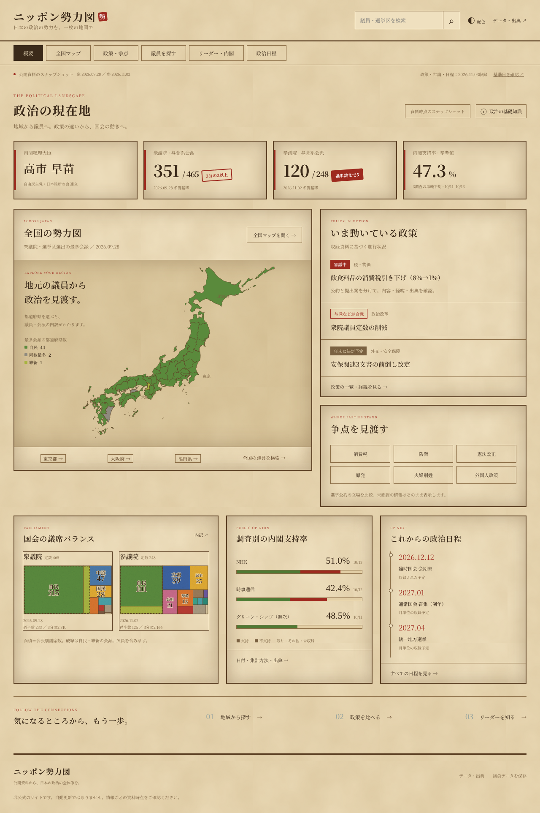
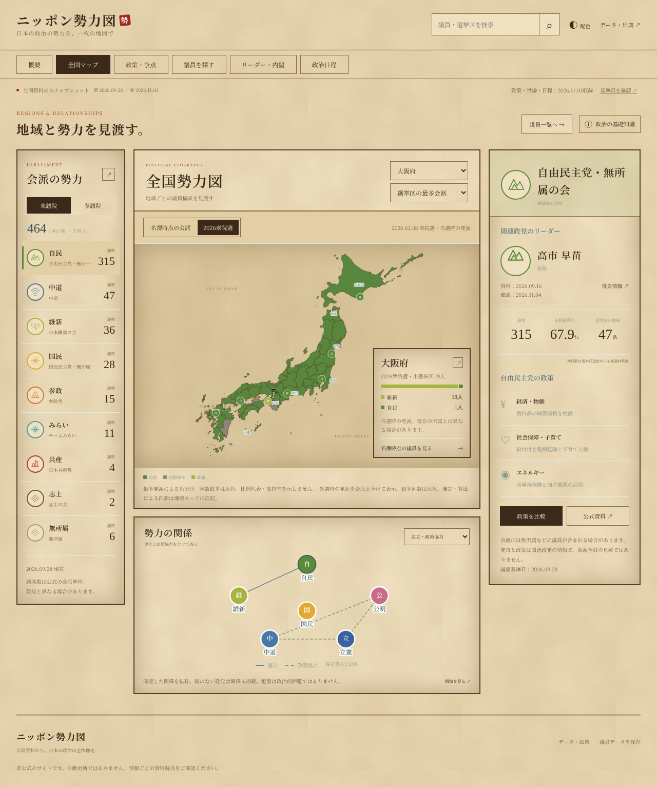
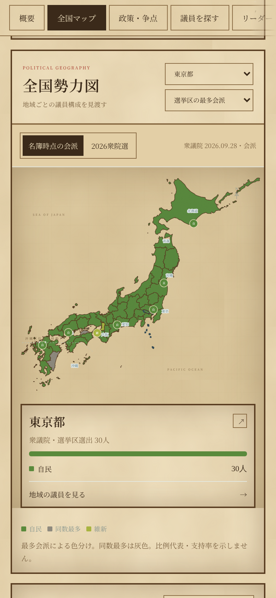
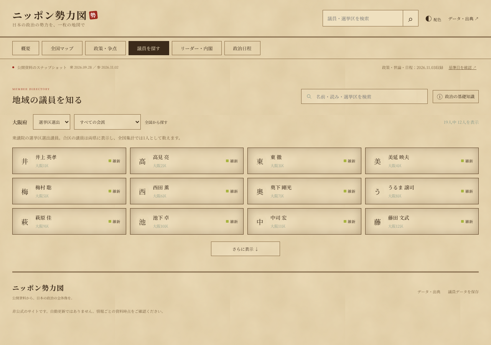
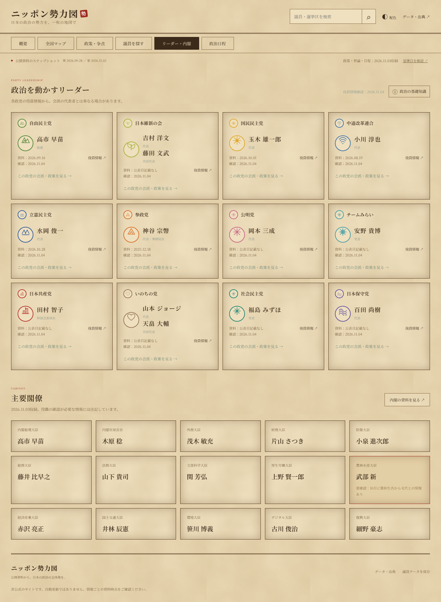
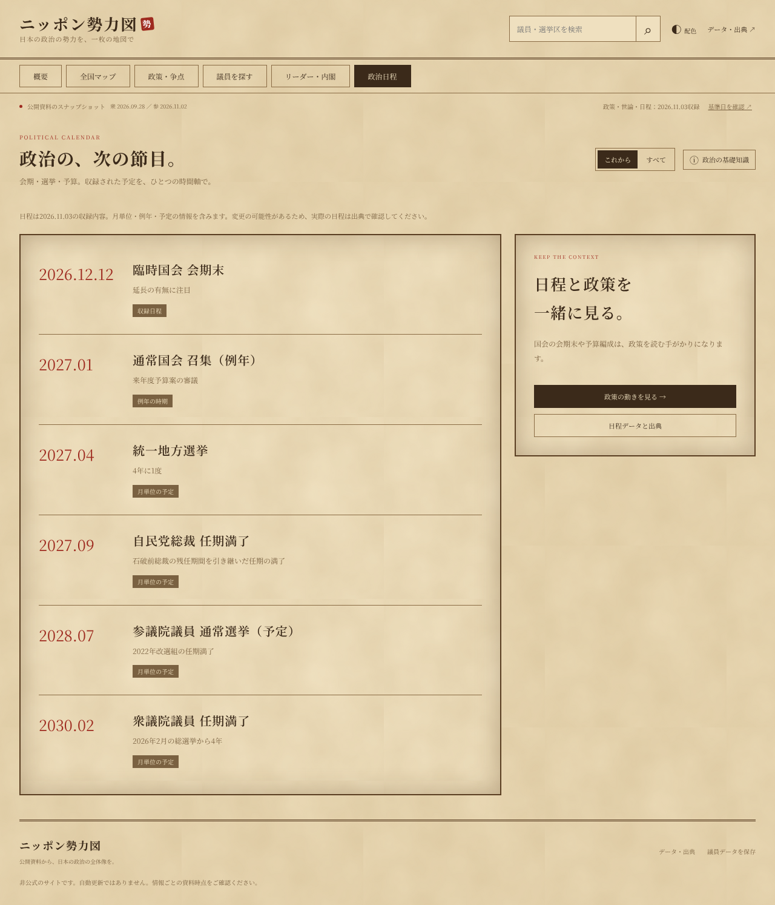
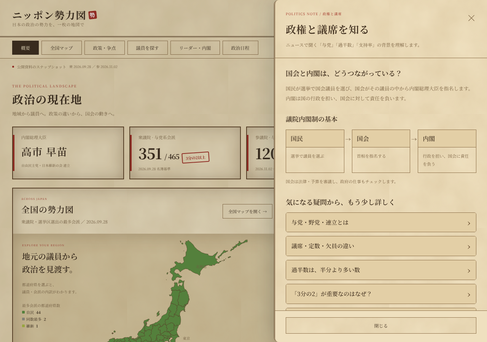
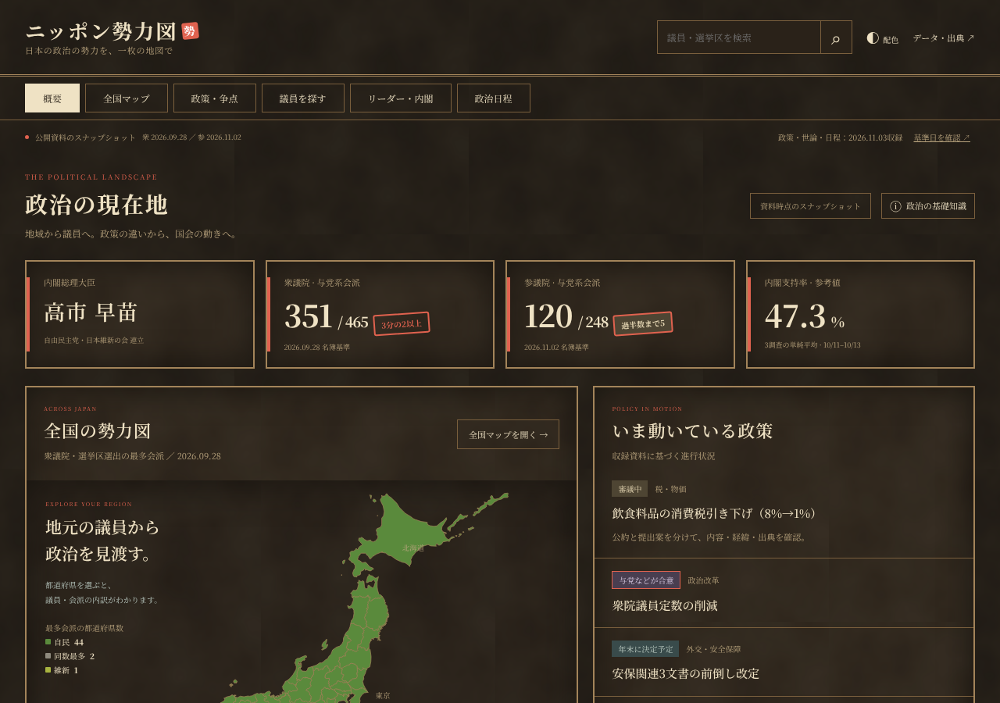

# ニッポン勢力図

日本の政治の勢力を、古地図風の「勢力図」で見渡すWebアプリです。地域から議員へ、政策の違いから国会の動きへと、6つの画面を行き来しながら政治の全体像をたどれます。

| PC | スマホ |
|---|---|
|  |  |

> 公開資料をもとにした非公式のサイトです。自動更新ではありません。情報ごとに資料の時点が異なるので、画面に表示した基準日と出典を確認してください。

## 6つの画面

画面上部のナビで切り替えます。どの画面にも「政治の基礎知識」ボタンがあり、その画面に関係する政治の仕組み（国会と内閣の関係、選挙制度、法律ができるまで など）を、短い文章と図で読めます。

### 1. 概要


いまの政治を1ページで見渡す画面です。

- **主要指標**：首相、衆参それぞれの与党系会派の議席、内閣支持率（直近3調査の単純平均）。過半数・3分の2に届いているかを朱色の判子で示します。
- **全国の勢力図**：都道府県を、選挙区選出の議員の最多会派の色で塗った地図。凡例に、最多会派ごとの都道府県数を出します。
- **いま動いている政策**、**争点を見渡す**（6争点への入口）、**国会の議席バランス**（面積が議席数に比例する図）、**調査別の内閣支持率**、**これからの政治日程**。

### 2. 全国マップ



- 都道府県を選ぶと、右下のカードにその地域の議員の会派別の内訳が出ます。「地域の議員を見る」で議員一覧へ移れます。
- **名簿時点の会派**と**2026衆院選（当選時の党派）**を切り替えられます。最多が同数の県は灰色です。
- 左の**会派の勢力**で会派を選ぶと、右に関連政党のリーダーと政策が出ます。衆議院・参議院を切り替えられます。
- **勢力の関係**：連立・政策協力、消費税、原発について、資料で確認できた関係だけを線で示します。線を選ぶと出典が出ます。



スマホでは、地図を画面幅に収め、地域のカードを地図の下に表示します。

### 3. 政策・争点


3つの切り替えがあります。

- **政策の動き**：食料品の消費税引き下げ法案、衆院定数の削減など、いま動いている政策。公約・提出・審議・成立の段階と出典を表示します。
- **6つの争点**：消費税、防衛、憲法改正、原発、選択的夫婦別姓、外国人政策について、10政党の2026衆院選の公約を比べます。原発・夫婦別姓などは立場ごとの分類も表示します。資料で確認できなかった立場は「未確認」と表示します。
- **政党を選んで比較**：12政党から1〜3党を選び、党の公式資料の政策を分野ごとに並べます。

### 4. 議員を探す



衆参711人の議員を、氏名・読み・選挙区で検索できます。地域、選挙区選出／比例代表、会派で絞り込めます。議員を選ぶと公式プロフィールへのリンクが出ます。画面右上の検索欄からも全国の議員を探せます。

### 5. リーダー・内閣



12政党の党首などのリーダーを、与党を先に、衆参の議席の多い順に並べています。資料の日付と確認日、役員情報の出典つきです。下に主要閣僚15人を並べ、確認が必要な情報には注記を付けています。

### 6. 政治日程



国会の会期、選挙、任期満了などの予定を時系列で並べます。「これから／すべて」を切り替えられます。「2027年1月」のように月単位の予定は、日付を補わずにそのまま表示します。

### 政治の基礎知識・ダークモード

| 政治の基礎知識 | ダークモード |
|---|---|
|  |  |

- **政治の基礎知識**：PCでは右側のパネル、スマホでは全画面で開きます。閉じるボタン、Escキー、背景のクリックで閉じます。
- **配色**：右上の「配色」ボタンで、夜の古地図風のダークモードに切り替えられます。最初はOSの設定に合わせます。

## 起動方法

ビルドは不要です。HTML・CSS・JavaScript（ES modules）だけで動きます（フォントのみ Google Fonts から読み込みます）。

```bash
npm start          # = python3 -m http.server 8000
# → http://localhost:8000 を開く
```

`fetch` で JSON を読み込むため、`index.html` を直接ダブルクリックして開くと動きません。上のようにローカルサーバーを起動してください。

GitHub Pages など静的ホスティングに、リポジトリの直下をそのまま公開できます。

## データと資料時点

表示データは `data/` にあります。自動では更新しないので、更新するときはファイルを直接書き換えます。

| ファイル | 内容 | 時点 |
|---|---|---|
| `data/data.json` | 公式の議員名簿、会派別人数、地図 | 衆院 2026-09-28（464人）、参院 2026-11-02（247人）。欠員各1 |
| `data/policies.json` | 12政党・4分野の公式政策の要約 | 原則2026年。公明は2025年、立憲は2021年の資料 |
| `data/leadership.json` | 各党のリーダーと、政党間の関係 | 2026-11-04 確認 |
| `data/snapshot.json` | 政権・閣僚・内閣支持率・政治日程 | 2026-11-03 収録 |
| `data/issues.json` | 政策の動き、6争点の公約比較 | 2026-11-03 収録 |
| `data/election.json` | 2026-02-08 衆院選の小選挙区・当選時の党派 | 2026-02-08 |

データの扱いで気をつけていること：

- **会派と政党を分ける**：議席数は公式の会派単位です。会派の人数を政党の人数と同じには扱わず、党の方針を会派全員の見解とはしません。
- **選挙結果と名簿を分ける**：2026衆院選の地図は当選時の党派、名簿の地図は各院の基準日の会派です。選挙時の「れいわ」「減ゆ」と名簿時点の「いのち」「志士」を自動で同じものにはしません。
- **推定値を明示する**：福岡の内訳は全国の合計からの推定、兵庫の内訳は維新の全国の議席からの算出です。地域カードに注記します。
- **状態を区別する**：公約・提出・審議・成立・施行は別の段階として扱います。支持率47.3%は3調査の単純平均で、調査方法の違いは補正していません。
- **確認の範囲**：収録した政策の進み具合・閣僚・日程・世論調査は、すべての一次情報を再確認したものではありません。「未確認」は、その党に方針がないという意味ではありません。

地図の形は、国土地理院「地球地図日本」と、そのGeoJSON変換 [dataofjapan/land](https://github.com/dataofjapan/land) にもとづきます。形を簡略化し、沖縄の位置を移し、一部の離島を省いています。政党の印（家紋風の図形）は本サイト独自の図案で、各党の公式ロゴではありません。

## 検証

Node.js 22以降で実行します。

```bash
npm ci
npm test
```

データ（議員数、会派の合計、議席図の面積、選挙結果の集計、同数・推定の注記など）と、画面の動作（6画面の切り替え、地域から議員への移動、検索・絞り込み、比較、政治の基礎知識の開閉とフォーカスの戻り、配色の切り替え、ブラウザの戻る操作 など）を検証します。画面の動作は開発用の [linkedom](https://www.npmjs.com/package/linkedom) で確認しており、本番のJavaScriptには含みません。

### 画面写真の撮り直し

READMEの画面写真は、次のコマンドで `docs/screenshots/` に撮り直せます（Playwright が必要です）。

```bash
npm i -D playwright && npx playwright install chromium   # 初回のみ
npm run screenshot
```

## 構成

```
index.html              画面の骨組み（6画面）
css/styles.css          レイアウトの基本
css/unified.css         各画面のスタイル
css/page-guide.css      政治の基礎知識パネル
css/theme.css           古地図風のテーマ（色・紙の質感・書体・ダークモード・スマホ調整）
js/unified.js           起動、画面の切り替え、概要・政策・日程・閣僚の描画
js/app.js               地図、会派、議員、リーダー、比較の描画
js/model.js             集計・検索・色などの処理
js/integration-model.js 選挙結果・支持率・日程の処理
js/seat-layout.js       議席図の配置計算と検証
js/page-guide.js        政治の基礎知識パネルの動作
js/guide-content.js     政治の基礎知識の本文
data/*.json             表示データ
scripts/verify.mjs      検証（npm test）
scripts/screenshot.cjs  README の画面写真（npm run screenshot）
docs/screenshots/       画面写真
```

## これまでの経緯

最初の1ページ版「ニッポン政治勢力図」と、別に作った「国会マップ」「アトラス版」を1つにまとめたものが、このサイトです。1ページ版の画面は削除し、そのデザイン（古地図風）と、選挙結果・政策・争点の比較・支持率・日程・閣僚のデータを引き継いでいます。
