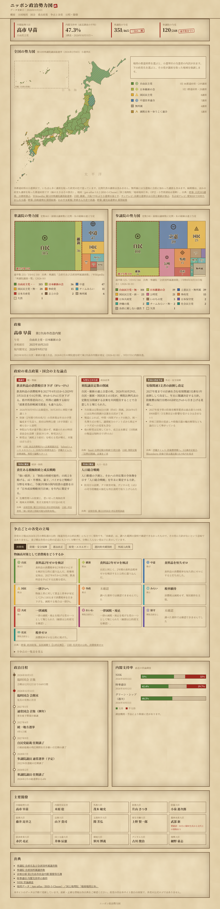
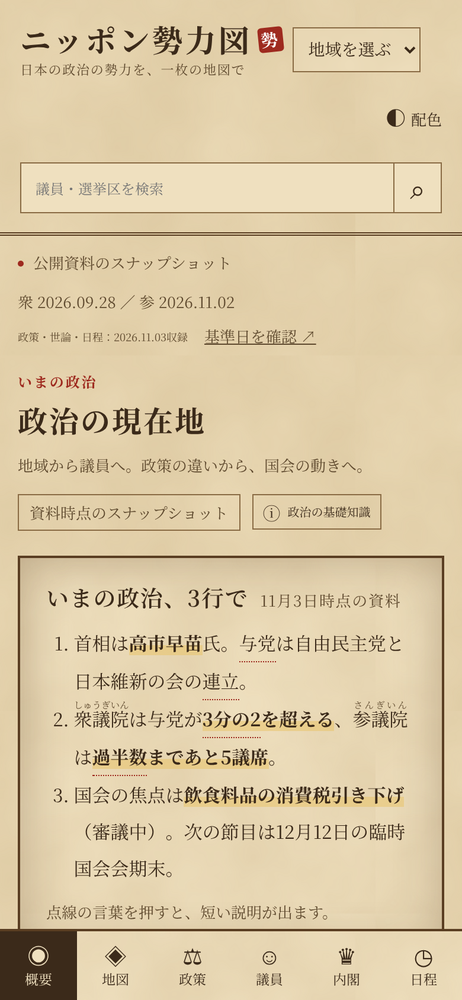
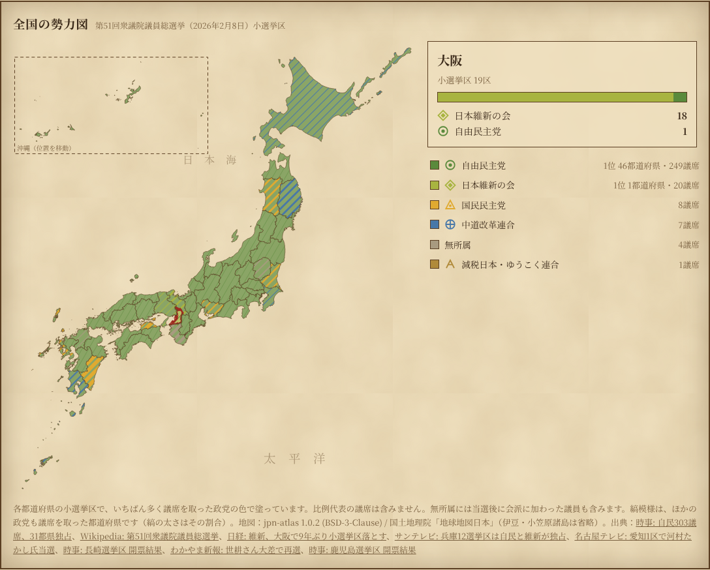
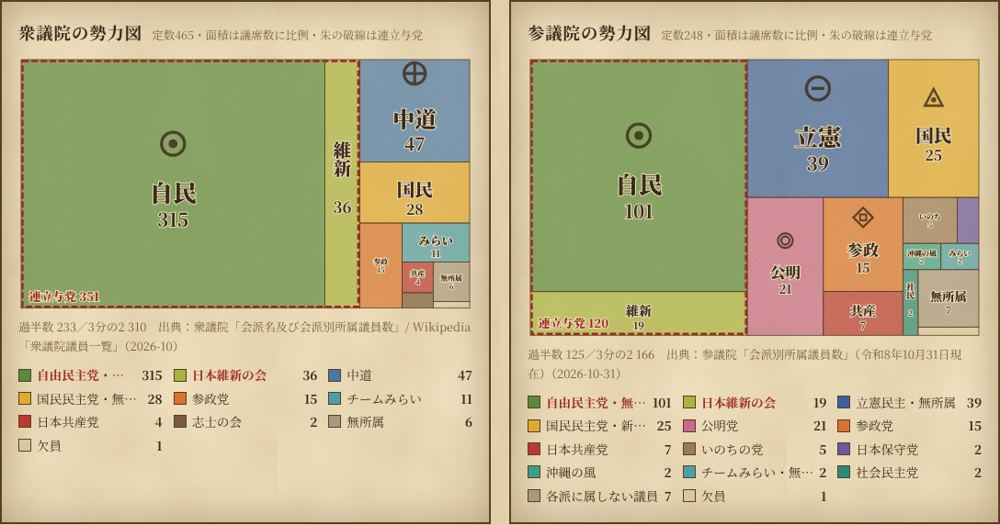
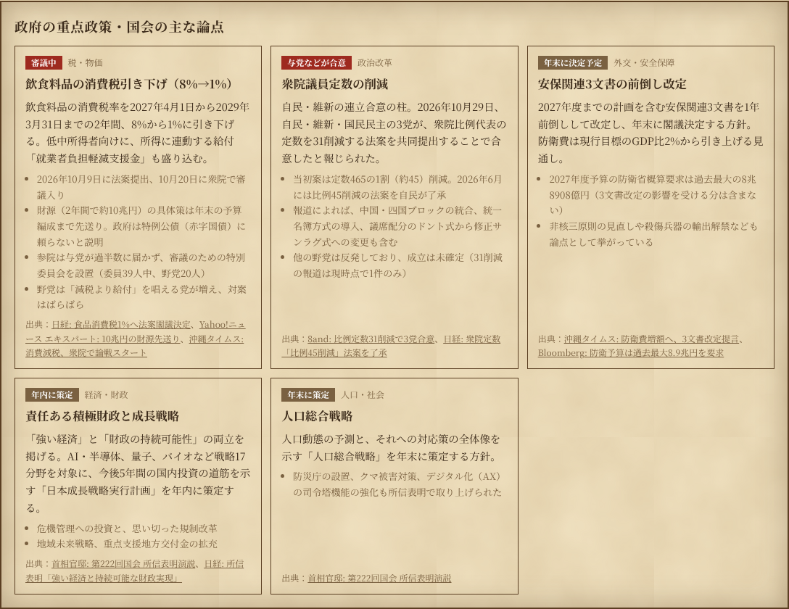
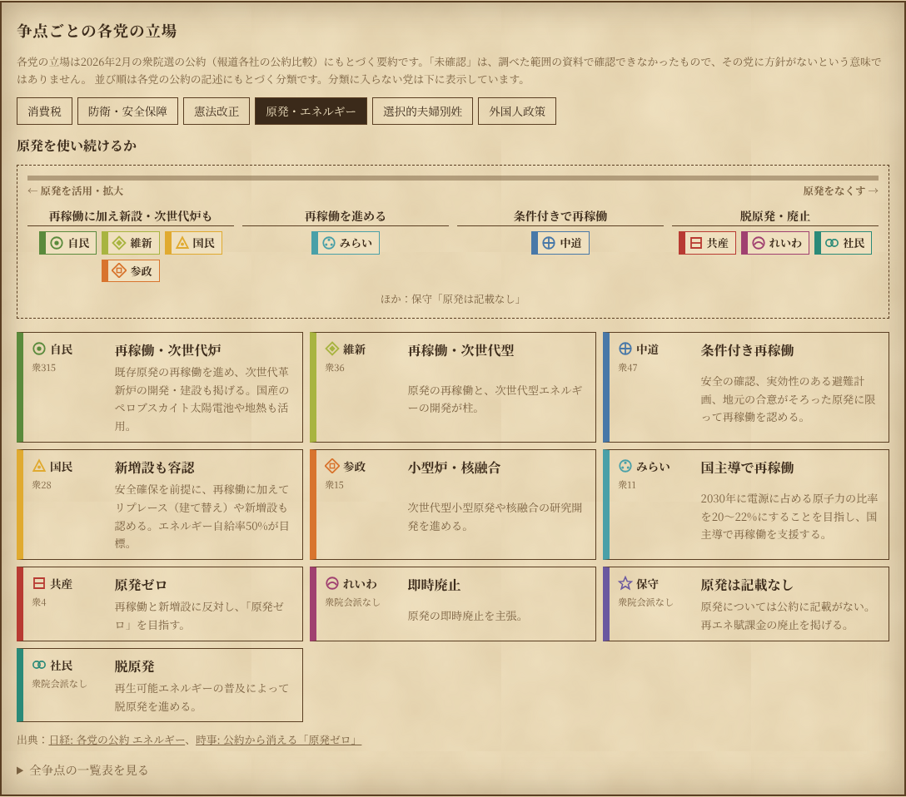

# ニッポン政治勢力図

日本の政治情勢を、古地図風の「勢力図」で一目で見るためのWebアプリです。全国の地図、国会の議席、政府の重点政策、争点ごとの各党の立場、内閣支持率、政治日程を1ページにまとめています。

| PC | スマホ |
|---|---|
|  |  |

## 統合デモ

従来の1ページ版に加え、国会マップ・アトラス版を組み合わせた[統合デモ](unified/README.md)を `unified/` に追加しています。概要、全国マップ、政策・争点、議員検索、リーダー・内閣、政治日程の6画面を移動できます。各ページには控えめな「政治の基礎知識」ボタンがあり、国会・選挙・法律・予算などの仕組みを短い文章と図で学べます。以下の画面写真・説明は従来版のものです。

```bash
npm start
# 従来版：http://localhost:8000/
# 統合版：http://localhost:8000/unified/
```

統合版だけを配信する場合は `npm run start:unified` を使用してください。ビルドは不要です。

検証には Node.js 22以降を使用します。本番表示にnpm依存パッケージは不要ですが、DOM動作テストには開発用のlinkedomを使います。

```bash
npm ci
npm test             # 従来版と統合版の両方
npm run test:unified  # 統合版のデータ・構文・DOM動作
```

資料は各画面に示した時点のスナップショットで、自動更新ではありません。統合版の資料由来・確認範囲は[専用README](unified/README.md)を参照してください。

## 画面の説明

### 1. 主要指標

ページの先頭に、首相、内閣支持率（直近の世論調査の平均）、衆参それぞれの与党の議席数を並べています。与党が過半数や3分の2を超えているかどうかは、朱色の判子風の印で示します。

### 2. 全国の勢力図



2026年2月の衆院選について、各都道府県の小選挙区でいちばん多く議席を取った政党の色で塗っています。

- **縞模様**の県は、ほかの政党も議席を取った県です。縞の太さは、その政党が取った議席の割合に比例します。
- **都道府県を選ぶ**（クリック・タップ・Enterキー）と、右側に当選者の党派別の内訳が出ます。
- **右の政党名を選ぶ**と、その党が議席を取った都道府県だけが強調されます。
- 地図を大きく描くため、沖縄県は左上の枠内に移しています。伊豆諸島・小笠原諸島は省いています。

### 3. 国会の勢力図



衆議院・参議院の会派を「領地」として描いています。**領地の面積は議席数に比例**します。

- 連立与党の領地は左側にまとめ、朱色の破線で囲んでいます。
- 細長い領地は縦書きで表示します。小さくて名前が入らない会派も、下の一覧で議席数を確認できます。
- 政党の印（家紋風の図形）は本アプリ独自の図案です。各党の公式ロゴではありません。

### 4. 政府の重点政策・国会の主な論点



食料品の消費税引き下げ法案、衆院定数の削減、安保3文書の改定など、いま動いている政策を、進み具合のバッジと要点、出典つきで並べています。バッジは、「審議中」などは赤、「年末に策定」など予定の段階はグレーです。

### 5. 争点ごとの各党の立場



消費税、防衛、憲法改正、原発、選択的夫婦別姓、外国人政策の6つの争点について、10党の立場を比べられます。

- タブで争点を切り替えると、各党の立場の短い要約と説明が出ます。
- 公約がはっきり分かれる**原発**と**選択的夫婦別姓**では、各党の旗を立場ごとに並べた図も表示します。
- 「全争点の一覧表を見る」を開くと、全争点×全政党の表が出ます。
- 資料で確認できなかった立場は、推測で埋めずに「未確認」と表示します。

### 6. 政治日程・内閣支持率・主要閣僚・出典

国会の会期や選挙の予定（次の予定を朱色で強調）、調査機関ごとの内閣支持率、主要閣僚、すべての出典リンクを載せています。

### 表示の切り替え

- **ダークモード**：OSの設定に合わせて、夜の古地図風の配色に切り替わります。
- **スマホ**：地図と内訳、議席図などが縦に並びます。

## 起動方法

ビルドは不要で、外部のJavaScriptライブラリも使っていません（フォントだけGoogle Fontsから読み込みます）。

```bash
npm start          # = python3 -m http.server 8000
# → http://localhost:8000 を開く
```

`fetch` で JSON を読み込むため、`index.html` を直接ダブルクリックして開くと動きません。上のようにローカルサーバーを起動してください。GitHub Pages など静的ホスティングにそのまま置けます。

## データの更新

表示データは `data/` の JSON ファイルにまとめています。

| ファイル | 内容 |
|---|---|
| [`data/politics.json`](data/politics.json) | 政権・議席・閣僚・支持率・日程・政党の色 |
| [`data/policies.json`](data/policies.json) | 重点政策、争点ごとの各党の立場 |
| [`data/prefectures.json`](data/prefectures.json) | 都道府県別の小選挙区の当選者数 |
| [`data/japan-map.json`](data/japan-map.json) | 都道府県の地図（SVGパス。下の手順で生成） |

### data/politics.json

| キー | 内容 |
|---|---|
| `updatedAt` | データ更新日 |
| `government` | 首相・内閣・与党 |
| `parties` | 政党キー、略称（`name`）、正式名（`full`）、表示色 |
| `houses[].factions` | 会派別議席。`ruling: true` を付けた会派を与党として集計 |
| `cabinet` | 閣僚（`note` を付けると要確認の注記を表示） |
| `polls` | 世論調査（`approve` / `disapprove` は %） |
| `calendar` | 政治日程（`YYYY-MM-DD` または `YYYY-MM`） |
| `sources` | 出典リンク |

### data/policies.json

| キー | 内容 |
|---|---|
| `agenda` | 政府の重点政策。`status` に「予定」「策定」を含むとグレー、それ以外は赤のバッジ |
| `issueParties` | 争点の比較に並べる政党キー |
| `issues[].positions` | 政党ごとの立場。`short` は一覧用の短い要約、`detail` は説明 |
| `issues[].spectrum` | （任意）旗を並べる図。`left` / `right` は軸の両端、`groups` は立場ごとの政党 |

資料で確認できない立場は `short` を `"未確認"` にし、推測で埋めないでください。どの項目にも出典（`sources`）が必要です。

### data/prefectures.json

| キー | 内容 |
|---|---|
| `totals` | 全国の小選挙区の党派別獲得数。都道府県の合計がこれと一致するかを検証します |
| `prefectures[].winners` | 都道府県ごとの党派別の当選者数 |
| `prefectures[].note` / `uncertain` | 注記。`uncertain: true` なら「要確認」と表示 |

### 地図データの作り直し

地図は [jpn-atlas](https://www.npmjs.com/package/jpn-atlas)（BSD-3-Clause、元データは国土地理院「地球地図日本」）から生成しています。

```bash
npm pack jpn-atlas@1.0.2 && tar xzf jpn-atlas-1.0.2.tgz
python3 scripts/build_map.py package/japan/japan.json data/japan-map.json
```

### 整合性チェック

更新したら、次のコマンドで整合性を確認します。

```bash
npm test
```

チェックする内容は次のとおりです。

- 会派の合計が定数と一致するか。過半数・3分の2の値が正しいか
- 議席図の面積が議席数に比例しているか
- 都道府県の当選者数が区数と一致するか。全国の合計が `totals` と一致するか
- 各争点に全政党の立場と出典がそろっているか。1つの党が複数の分類に入っていないか

### 画面写真の撮り直し

READMEの画面写真は、次のコマンドで `docs/screenshots/` に撮り直せます（Playwright が必要です）。

```bash
npm i -D playwright && npx playwright install chromium   # 初回のみ
npm run screenshot
```

## 構成

```
index.html              画面の骨組み
css/style.css           古地図風のスタイル（ダークモード・スマホ対応）
js/app.js               描画
js/lib.js               議席図の配置計算・集計・検証（DOM に依存しない処理）
js/emblems.js           政党の印（家紋風の独自図案）
data/*.json             表示データ
scripts/validate.mjs    データ整合性チェック（npm test）
scripts/build_map.py    地図データの生成
scripts/screenshot.cjs  README 用の画面写真（npm run screenshot）
docs/screenshots/       画面写真
```

## 今後の拡張案

- 地図の切り替え（参院選の選挙区、比例代表の得票など）
- 支持率の推移グラフ
- 争点の追加（社会保障、教育、子育て、政治とカネなど）
- GitHub Actions によるデータの定期更新
